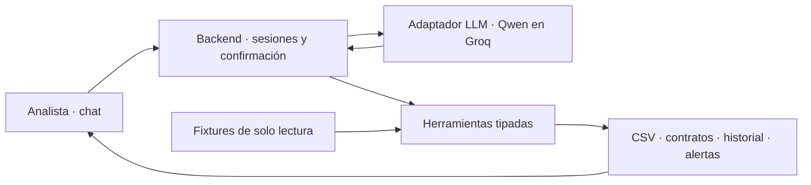

# Solución del reto 02

## 1. Problema y usuario

Administración carece de un registro completo y actualizado de contratos porque el proceso depende de envíos comerciales dispersos y de una persona que ya no está. Esto dificulta anticipar renovaciones, pólizas y obligaciones. El agente asiste al analista; Administración conserva la responsabilidad del maestro y Comercial la obligación de entregar documentos completos.

## 2. Arquitectura

Comportamiento: prompt Markdown. Conocimiento: reglas documentadas del proceso. Ejecución: herramientas independientes del servidor. La interfaz propia `LlmAdapter.enviar(messages, tools)` devuelve texto, llamadas y uso de tokens. El ciclo no depende del formato de Groq. El adaptador convierte mensajes y esquemas a la API compatible; cada resultado de herramienta vuelve al modelo con su identificador.

La demo conserva archivos locales para que el evaluador inspeccione qué se registró. El buzón y SharePoint son simulados; Qwen es un modelo real solo cuando se configura su clave. El modo de práctica tiene un flujo programado y se identifica como tal. No se presenta como una prueba con IA.

## 3. Ciclo del agente y control humano

El modelo decide qué herramienta solicitar; el backend valida argumentos zod, ejecuta y registra la operación. Hasta 25 iteraciones por turno, presupuesto acumulado configurable, límite diario en memoria, timeout de proveedor y límite HTTP por IP. Los errores se devuelven en lenguaje claro sin exponer credenciales.

Los datos registrados deben coincidir con la extracción determinista o una revisión humana autorizada. `confirmado=true` propuesto por el modelo no constituye autorización. Una validación pendiente genera un token ligado a sesión, mensaje y contrato. El formulario muestra evidencia y permite confirmar valor e inicio/fin; el siguiente turno consume ese token. Si interviene otro turno, la confirmación vence. La herramienta vuelve a validar antes de escribir. Las fechas siguen teniendo que ser válidas.

Las instrucciones dentro de contratos o correos son contenido no confiable. El prompt prohíbe obedecerlas y el backend limita las operaciones a herramientas conocidas. No se ejecuta shell desde herramientas.

## 4. Elección del modelo y costos

La propuesta inicial era Qwen3.5 Plus en Alibaba. Al inspeccionar la configuración —sin copiar secretos— de las apps del candidato se identificó Qwen vía Groq. Para reutilizar su proveedor conocido, el valor de ejemplo es **qwen/qwen3.8-27b**, `reasoning_effort=none`, temperatura 0. Alibaba permanece soportado configurando su endpoint y modelo. Esto es una decisión para el prototipo y requiere prueba real con una clave válida.

El modelo coordina y comunica; las reglas y los valores monetarios no quedan a su criterio. Su utilidad es pedir operaciones en lenguaje natural y explicar excepciones con evidencia. La extracción de estos seis textos no requiere razonamiento generativo.

La referencia publicada de Groq para este modelo es USD 0,80 por millón de tokens de entrada y USD 4,00 de salida. Un escenario ilustrativo de 15.000 tokens de entrada acumulados y 2.000 de salida da **USD 0,020 por caso**. No incluye hosting ni es una medición de esta app. La app acumula `usage.total_tokens`; para costo exacto de producción hay que desglosar entrada, salida y tarifas vigentes del proveedor. La estimación inicial de USD 0,003 correspondía a otro modelo/proveedor, por lo que no debe trasladarse a Groq.

Fuentes: [modelo Groq](https://console.groq.com/docs/model/qwen/qwen3.8-27b), [modelos y tarifas](https://console.groq.com/docs/models), [tool calling](https://console.groq.com/docs/tool-use/overview), [Alibaba compatible](https://www.alibabacloud.com/help/en/model-studio/qwen-api-via-openai-chat-completions).

## 5. Extracción y confianza

Se extraen ID, partes, identificador sin dígito de verificación, objeto, valor, moneda, fechas y garantías mediante expresiones y reglas sobre los TXT. Cada campo incluye fuente y confianza. El país se deriva del tipo/longitud de identificador; el comercial se resuelve contra el catálogo. Ausencias son null y confianza 0; valor indeterminado es 0 con bandera y revisión. La ausencia de garantías se interpreta como no aplica con confianza 0,85, suficiente para los fixtures pero debe revisarse con documentos de producción.

Confianza es una puntuación heurística documentada, **no una probabilidad calibrada**. Datos literales: 0,98; inferencias respaldadas: 0,85–0,90; valor por demanda: 0,50; ausencia: 0. Umbral de revisión: 0,80. Para un otrosí se heredan del maestro los campos no modificados, con esa fuente explícita. Las garantías ampliadas quedan pendientes.

Duplicado: mismo ID, valor e inicio/fin. Actualización: mismo ID o NIT y similitud de tokens del objeto >=0,90. En otrosí se actualizan campos modificados; cambios en documentos ordinarios requieren revisión. La similitud simple puede fallar con paráfrasis: antes de producción se debe evaluar con documentos reales y revisión por riesgo.

## 6. Regla de gobierno propuesta

**Dueño:** Administración responde por calidad, acceso y actualización del maestro. Cada gerente comercial responde por la entrega de su cartera. La dirección patrocina y resuelve incumplimientos; un asesor jurídico externo revisa las excepciones que impliquen interpretación legal.

**Canal:** `contratos@periferia-ficticia.com` representa el buzón único de esta demo. En producción se creará o confirmará el buzón corporativo aprobado. El comercial envía PDF firmado, anexos, otrosíes y actas de terminación dentro de dos días hábiles de firma. Asunto: `[Contrato][Cliente][ID][Nuevo/Otrosí/Terminación]`.

**Acuse:** al recibir, enviar un acuse con ID de seguimiento y estado, idealmente en minutos; Administración resuelve o asigna excepciones en un día hábil. La demo registra estados pero no envía acuses externos.

**Excepciones:** sin firma, monto o fecha identificable, la recepción queda pendiente; se solicita el dato al comercial, no se completa por intuición. Tras dos días hábiles sin respuesta se escala a su gerente. Un contrato por demanda requiere confirmar ese carácter y registrar obligaciones condicionales; no implica que no haya exposición económica. El agente tampoco certifica que una firma o póliza sea válida.

**Recuperación de junio–agosto:** campaña de diez días hábiles: extraer la cartera facturada del período, cruzarla por cliente/contrato con el maestro, asignar faltantes al comercial, recuperar documentación firmada y cerrar excepciones con Administración. Un listado de registros desde el corte no equivale a demostrar que todo el faltante fue recuperado.

**Indicador mensual:** contratos distintos facturados en el mes que tienen documento y registro vigente / contratos distintos facturados en el mes. Administración publica cobertura, antigüedad de pendientes y causas; medir una línea base y acordar una meta inicial del 95%. Complementar con porcentaje recibido dentro de dos días hábiles, revisión manual y tiempo de procesamiento. No sumar importes entre monedas sin conversión acordada.

## 7. Decisiones y alternativas

1. **Reglas deterministas para registrar:** facilitan trazabilidad de montos y fechas. Extracción exclusivamente generativa descartada por riesgo de alteraciones y menor reproducibilidad.
2. **CSV y archivos:** permiten inspección y cumplen el PRD. Base de datos descartada para el plazo; se necesitará para concurrencia, atomicidad y recuperación en producción.
3. **Adaptador LLM propio:** permite cambiar de proveedor sin reescribir las herramientas. Acoplar lógica a Groq descartado porque la organización puede usar Vertex o Bedrock.
4. **Revisión de firma imprecisa:** `msg-006` no contiene día exacto. Usar la fecha del correo como si fuera fecha contractual se descartó; se confirma también fecha_inicio, además de valor y fin. Es una ampliación explícita del ejemplo del PRD.
5. **Render para la demo:** ejecuta el servidor y sus archivos con pocos cambios. La limitación de almacenamiento temporal se informa. Una migración a Vercel o Sites requiere persistencia externa y adaptación del runtime.

## 8. Supuestos

Los documentos son ficticios y legibles. No se implementa OCR, buzón corporativo, SharePoint, envío de correo ni validación criptográfica de firmas. Los TXT se archivan conservando su extensión; no se convierten artificialmente a PDF. La extracción sin número podría generar AUTO al registrar, aunque esa rama no aparece en los seis casos. `comercial=null` se informa y no bloquea. El corte y la fecha de defensa son los del PRD, no la fecha real de la computadora.

## 9. Cobertura

| Historia             | Estado                              | Pendiente para producción                       |
| -------------------- | ----------------------------------- | ----------------------------------------------- |
| Leer buzón           | Hecho con fixtures                  | Integración Graph/Gmail, permisos y acuses      |
| Extraer datos        | Hecho para TXT y variantes probadas | PDF, OCR y evaluación de nuevos formatos        |
| Validar y clasificar | Hecho                               | Calibrar reglas con corpus real y expertos      |
| Registrar y archivar | Hecho en archivos                   | Transacciones, ACL, SharePoint y recuperación   |
| Alertar              | Hecho como reporte                  | Programación, responsables y entrega externa    |
| Manejo de errores    | Hecho para escenarios probados      | Telemetría central, soporte y ensayos de fallos |

El modo real requiere configurar una clave y completar la prueba end-to-end con el proveedor. El enlace público depende de crear el servicio en la cuenta de hosting. Estas dos verificaciones no deben darse por hechas por ejecutar la demo sin modelo.

## 10. Uso de IA

Se utilizó Codex/ChatGPT para leer el PRD, proponer arquitectura, implementar el chat y las herramientas, escribir pruebas y documentación, y preparar el guion estratégico. Se descartó usar la fecha del correo como fecha contractual automática. Se corrigió en pruebas una comparación dependiente del orden de propiedades JSON y se agregó soporte a la variante de identificación que no dice “identificada con”. El candidato debe recorrer código y escenarios antes de defenderlos. No se afirma uso de otros asistentes ni resultados de revisiones no realizadas.

## 11. Riesgos y paso a producción

Priorizar: extracción equivocada, documentos faltantes, falsos duplicados, uso de datos sensibles, reintentos y escritura parcial. Mitigaciones: evidencia por campo, revisión por riesgo, conciliación contra facturación, permisos por rol, cifrado, transacciones/idempotencia, respaldo y evaluación periódica. El archivo CSV, historial y copia documental no forman una transacción atómica conjunta: una caída entre escrituras requiere conciliación. La cola HTTP protege un solo proceso, no varias instancias.

Instrumentar latencia, tokens/costo por caso, tasa de revisión, campos corregidos, rechazos, fallos y cobertura. Piloto con Administración en paralelo al proceso vigente; habilitar escritura real solo tras acordar calidad y manejo de excepciones. Evaluar retorno con volumen × minutos manuales evitados, restando revisión y costo operativo, sin atribuir ahorros no medidos.

**Vertex AI / Bedrock:** implementar otro `LlmAdapter` que traduzca mensajes, esquemas, tool calls, respuestas y consumo al SDK de la plataforma aprobada. Probar los mismos escenarios más confirmación y fallos; usar IAM/identidad de servicio y secretos corporativos, elegir región, modelo y políticas según disponibilidad. La portabilidad es de interfaz y pruebas; no se promete cambiar solo una URL ni tener estos adaptadores implementados. Después sustituir el repositorio de archivos por SharePoint/BD según gobernanza.

Fuentes: [Bedrock tool use](https://docs.aws.amazon.com/bedrock/latest/userguide/tool-use.html), [Google function calling](https://docs.cloud.google.com/gemini-enterprise-agent-platform/models/tools/function-calling), [Render gratuito](https://render.com/docs/free).
